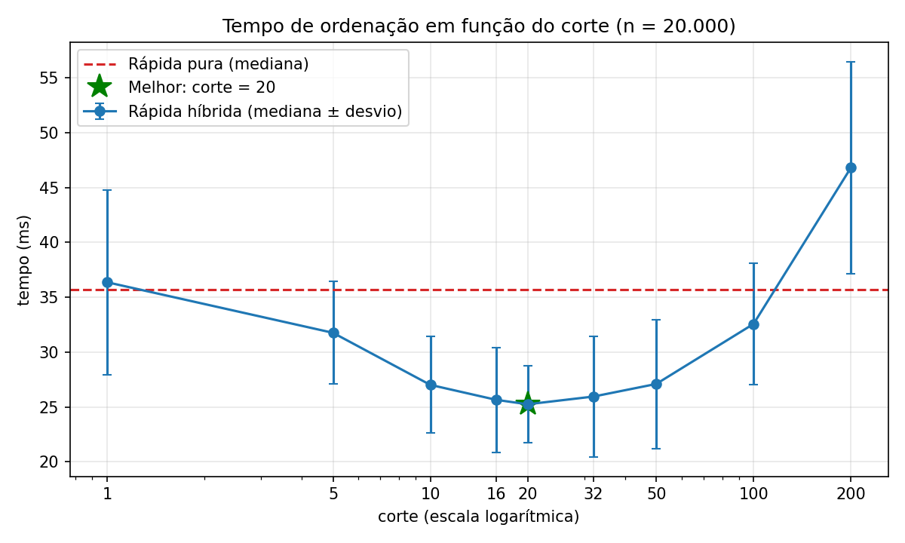

# Análise de Desempenho do Quicksort Híbrido

## 1. Introdução

O Quicksort é um algoritmo de ordenação baseado na estratégia de divisão e conquista. Ele escolhe um elemento como pivô, divide os demais elementos em partições e aplica o mesmo procedimento recursivamente até que a lista esteja ordenada.

Apesar de apresentar desempenho médio de \(O(n \log n)\), o Quicksort pode realizar chamadas recursivas e operações de particionamento desnecessárias quando trabalha com sublistas pequenas. Uma alternativa para reduzir esse custo é utilizar uma abordagem híbrida, combinando o Quicksort com o algoritmo Insertion Sort.

Este trabalho tem como objetivo implementar e avaliar um Quicksort híbrido, verificando como diferentes valores de corte influenciam o tempo de execução e comparando os resultados com os obtidos pelo Quicksort puro.

## 2. Implementação dos algoritmos

Foram implementadas duas versões do Quicksort: a versão pura e a versão híbrida.

### 2.1. Quicksort puro

A implementação do Quicksort puro escolhe aleatoriamente um pivô para dividir os elementos da lista em três grupos:

- **Menores:** elementos menores que o pivô;
- **Iguais:** elementos iguais ao pivô;
- **Maiores:** elementos maiores que o pivô.

O algoritmo aplica recursivamente o mesmo procedimento às partições menores e maiores, combinando os resultados para produzir a lista ordenada.

A escolha aleatória do pivô ajuda a reduzir a dependência do desempenho em relação à disposição inicial dos elementos.

### 2.2. Quicksort híbrido

O Quicksort híbrido utiliza a mesma estratégia de particionamento, mas substitui o Quicksort pelo Insertion Sort quando o tamanho da sublista fica abaixo do valor de corte definido.

O parâmetro `corte` determina o tamanho a partir do qual essa substituição ocorre. Dessa forma, o algoritmo permite avaliar diferentes combinações entre os dois métodos de ordenação.

Quando o corte é igual a 1, nenhuma sublista com mais de um elemento é direcionada ao Insertion Sort. Nesse caso, o algoritmo mantém o comportamento de particionamento do Quicksort puro.

## 3. Metodologia dos experimentos

Os experimentos foram realizados com os seguintes parâmetros:

- **Quantidade de elementos:** 20.000;
- **Distribuição dos dados:** valores aleatórios;
- **Repetições:** 50 execuções para cada configuração;
- **Valores de corte:** 1, 5, 10, 16, 20, 32, 50, 100 e 200;
- **Referência de comparação:** Quicksort puro.

Para tornar a comparação mais consistente, as configurações foram avaliadas utilizando os mesmos conjuntos de dados em cada repetição. A ordem das medições foi embaralhada, e as sementes utilizadas na escolha dos pivôs foram controladas durante as comparações.

Os resultados de cada configuração foram verificados para garantir que as listas produzidas estivessem corretamente ordenadas.

O tempo de execução foi medido em cada repetição. Para a comparação principal, utilizou-se a mediana dos tempos, uma medida menos sensível a execuções excepcionalmente lentas ou rápidas.

Os dados consolidados foram registrados no arquivo `dados/resultados.csv`, que contém os resultados necessários para consultar e comparar o desempenho dos algoritmos.

## 4. Resultados obtidos

A tabela apresenta os resultados registrados no arquivo `dados/resultados.csv`. A coluna de ganho indica a redução percentual do tempo mediano em relação ao Quicksort puro. Valores positivos representam melhora de desempenho, enquanto valores negativos indicam que a versão híbrida foi mais lenta.

| Configuração | Tempo mediano (ms) | Ganho sobre o Quicksort puro |
|---|---:|---:|
| Quicksort puro | 35,69 | Referência |
| Corte 1 | 36,37 | -1,9% |
| Corte 5 | 31,76 | +11,0% |
| Corte 10 | 27,01 | +24,3% |
| Corte 16 | 25,65 | +28,1% |
| Corte 20 | 25,24 | +29,3% |
| Corte 32 | 25,95 | +27,3% |
| Corte 50 | 27,10 | +24,1% |
| Corte 100 | 32,57 | +8,7% |
| Corte 200 | 46,81 | -31,2% |

*Fonte: resultados experimentais registrados em `dados/resultados.csv`.*

### 4.1. Melhor valor de corte

Entre os valores avaliados, o corte igual a 20 apresentou o menor tempo mediano, de aproximadamente 25,24 milissegundos.

Em comparação com o Quicksort puro, que apresentou tempo mediano de 35,69 milissegundos, essa configuração obteve uma redução de aproximadamente 29,3% no tempo de execução.

Os cortes 16 e 32 também apresentaram bons resultados. Isso indica que o desempenho não depende de um único valor exato, mas de uma faixa de cortes que equilibra os custos de particionamento do Quicksort e de ordenação por inserção.

O corte 20 foi o melhor entre os valores testados neste experimento. Esse resultado não significa que ele será necessariamente o melhor para qualquer quantidade de elementos, distribuição de dados ou ambiente de execução.

### 4.2. Efeito de valores de corte elevados

Os resultados mostram que aumentar o corte indefinidamente não melhora o desempenho do algoritmo.

Com o corte 50, o tempo mediano aumentou em relação aos cortes 16, 20 e 32. Com o corte 100, o ganho em relação ao Quicksort puro caiu para aproximadamente 8,7%. Já com o corte 200, o algoritmo híbrido foi aproximadamente 31,2% mais lento que a versão pura.

Esse comportamento ocorre porque o Insertion Sort possui custo quadrático, \(O(n^2)\), no pior caso. Quando o corte é muito elevado, sublistas maiores são ordenadas por inserção, aumentando o número de operações necessárias.

Portanto, o valor de corte precisa ser escolhido de maneira equilibrada: deve ser suficiente para reduzir o custo das chamadas recursivas em sublistas pequenas, mas não tão alto a ponto de tornar o Insertion Sort responsável por uma parcela excessiva do trabalho.

## 5. Gráfico de desempenho

A Figura 1 apresenta o desempenho do Quicksort híbrido para os diferentes valores de corte avaliados, em comparação com o Quicksort puro.

**Figura 1 – Comparação do tempo de execução do Quicksort híbrido para diferentes valores de corte.**

*Fonte: elaborado pelos autores a partir dos resultados experimentais.*

O eixo horizontal representa os valores de corte utilizados pelo algoritmo híbrido, enquanto o eixo vertical representa o tempo de execução. A linha de referência do Quicksort puro permite comparar o desempenho de cada configuração.

Observa-se que o tempo mediano diminui conforme o corte aumenta de 1 até 20. A partir desse ponto, os tempos voltam a crescer, indicando que cortes maiores nem sempre proporcionam melhor desempenho.

O corte 20 apresentou o menor tempo mediano entre as configurações avaliadas, com aproximadamente 25,24 milissegundos. Esse resultado reforça a importância de equilibrar o custo das chamadas recursivas do Quicksort com o custo de ordenação por inserção.

## 6. Verificação do corte igual a 1

Um dos requisitos do experimento é verificar se o Quicksort híbrido com corte igual a 1 se comporta como o Quicksort puro.

Nesse caso, o Insertion Sort não é utilizado para sublistas com mais de um elemento. Assim, o algoritmo mantém a estratégia de particionamento do Quicksort, e ambas as versões produzem o mesmo resultado para uma mesma entrada.

As medições de tempo não precisam ser numericamente idênticas, pois podem sofrer pequenas variações decorrentes do ambiente de execução e das características da implementação. Nos resultados obtidos, o corte 1 apresentou tempo mediano de 36,37 milissegundos, próximo ao tempo de 35,69 milissegundos do Quicksort puro.

Essa diferença de tempo não significa, por si só, que os algoritmos tenham estratégias de ordenação diferentes nesse caso. A verificação também considera o comportamento do algoritmo e a ausência de chamadas ao Insertion Sort para sublistas com mais de um elemento.

## 7. Conclusão

Os experimentos demonstraram que a combinação do Quicksort com o Insertion Sort pode reduzir o tempo de execução da ordenação, desde que o valor de corte seja escolhido adequadamente.

Entre os valores avaliados, o corte 20 apresentou o melhor resultado, com tempo mediano de 25,24 milissegundos e ganho aproximado de 29,3% em relação ao Quicksort puro.

Também foi observado que valores de corte muito elevados podem prejudicar o desempenho. Isso acontece porque o custo quadrático do Insertion Sort passa a influenciar mais significativamente a execução.

A análise confirma a importância de avaliar experimentalmente os parâmetros de um algoritmo híbrido, pois a escolha adequada depende do equilíbrio entre os custos dos algoritmos utilizados.

Por fim, o corte igual a 1 preserva o comportamento de particionamento do Quicksort puro, enquanto os resultados do experimento mostram que cortes intermediários, especialmente entre 16 e 32, oferecem o melhor desempenho nas condições avaliadas.

## 8. Arquivos de resultados

Os resultados do experimento são disponibilizados em dois arquivos:

- **`dados/resultados.csv`:** reúne os dados numéricos das medições, permitindo consultar e comparar os tempos de execução e os ganhos relativos das configurações avaliadas.
- **`dados/resultados.png`:** apresenta a visualização gráfica dos resultados, facilitando a identificação do valor de corte com melhor desempenho e a comparação com o Quicksort puro.

Em conjunto, os arquivos permitem analisar tanto os valores individuais das medições quanto o comportamento geral do algoritmo híbrido.
